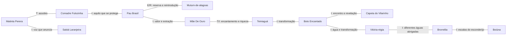

# Relações entre as unidades: histórias, lugares e elementos

**Data:** 27/10/2026  
**Escopo:** 66 nomes reunidos — 45 unidades presentes no projeto e 21 candidatas da pesquisa anterior.  
**Natureza do documento:** pesquisa comparativa e interpretação narrativa. Não altera o jogo.

## 1. O ponto de partida

Aqui, cada unidade é considerada pelo que representa: uma história, um ser vivo, uma paisagem, uma imagem ou um medo. Nenhuma classe, origem, função de combate ou classificação anterior foi usada para construir as relações.

O resultado é uma **rede de relações sobrepostas**. Uma mesma personagem pode conversar com várias outras por motivos diferentes. Matinta Perera pode se aproximar do Sabiá pelo som, do Boto pela mudança de aparência e da Comadre Fulozinha pelo contato com humanos. Essas aproximações não significam que todos participem da mesma história.

As relações também podem ser de oposição: acolher e ameaçar; orientar e desorientar; conservar e extrair; aparecer e desaparecer. Não pressupõem amizade, parentesco ou antagonismo já estabelecido nas tradições.

### Como ler a evidência

| Marca | O que sustenta a relação | Limite |
| --- | --- | --- |
| **T — narrativa registrada** | Um motivo aparece em versões documentadas das histórias comparadas. | Compartilhar um motivo não demonstra uma narrativa comum nem uma descendência histórica. |
| **E — ecologia ou história documentada** | Biologia, ambiente, conservação ou história material. | Uma relação ambiental não prova convivência entre quaisquer duas espécies. |
| **R — associação regional** | Registros situam as histórias em um mesmo lugar ou percurso. | Proximidade geográfica não torna duas personagens integrantes da mesma tradição. |
| **I — interpretação proposta** | Comparação de formas, símbolos, contrastes e possibilidades de encontro. | É uma leitura deste documento, não uma afirmação do folclore. |

Quando uma relação mistura evidência e interpretação, ambas aparecem. Nomes amplos como Bromélia e Mãe-D'Água exigem atenção: não identificam, por si só, uma espécie ou versão narrativa única. As descrições de combate do projeto não são usadas como fontes culturais.

## 2. Os fios que atravessam o conjunto

### 2.1 O som anuncia alguém que ainda não vemos

**Encontro principal:** Matinta Perera, Comadre Fulozinha e Sabiá Laranjeira.

O assobio de Matinta participa de uma sequência de contato, promessa e cobrança; em versões da Comadre, o assobio acompanha sua presença na mata. O Sabiá acrescenta a voz de um animal reconhecível. A aproximação permite perguntar: **quando um som é apenas um som e quando passa a ser um chamado?** [Matinta — Portal Amazônia](https://portalamazonia.com/amazonia-de-a-a-z/m/matinta-perera/), [Comadre — Fundaj](https://pesquisaescolar.fundaj.gov.br/pt-br/artigo/sitio-dos-pintos-bairro-recife/).

**Relação:** T entre os motivos sonoros das duas personagens; I na aproximação com o Sabiá. Ararinha-azul e Arara-azul-de-lear ampliam a presença de aves, mas não são manifestações de Matinta. Não há aqui afirmação de identidade entre uma ave real e a personagem.

### 2.2 Entrar num lugar exige aprender suas regras

**Encontro principal:** Curupira, Caapora, Anhangá, Comadre Fulozinha, Pai do Mato e Boitatá.

Essas figuras permitem comparar limites impostos à ação humana sobre a paisagem, embora suas versões e condutas variem. Curupira tem associação documentada à proteção das florestas; a Comadre pune desrespeitos à natureza no relato recifense consultado. Boitatá acrescenta a proteção relacionada ao fogo. [Curupira — Governo de São Paulo](https://www.infraestruturameioambiente.sp.gov.br/ipa/2024/07/no-dia-de-protecao-as-florestas-relembre-a-saga-do-curupira-no-estado-de-sao-paulo/), [Boitatá — MultiRio](https://multi.rio/index.php/conteudo-geral/13060-boitat%C3%A1).

**Pontes:** Pau Brasil, Palmito-juçara, Sumaúma, Araucária, Onça-pintada e Mutum-de-alagoas tornam concreta a pergunta sobre aquilo que merece proteção. Relacionar essas espécies a uma determinada personagem é I: não pressupõe que a tradição já descreva essa parceria.

**Tensão produtiva:** uma presença pode ser protetora para a paisagem e assustadora para quem a atravessa. Mapinguari pode entrar nessa conversa como imagem do encontro com algo que não se consegue dominar, sem receber automaticamente o mesmo papel moral das outras figuras.

### 2.3 Perder-se, deixar rastros e encontrar ajuda

**Encontro principal:** Curupira, Mãozão, Pé-de-Garrafa, Saci-Pererê e Anta Bondosa.

Pés, pegadas e desorientação ligam modos diferentes de perceber um caminho. No material pantaneiro consultado, Mãozão desorienta e Anta Bondosa aparece associada ao amparo de crianças perdidas; Pé-de-Garrafa acrescenta uma marca corporal reconhecível. Não são três personagens de um mesmo episódio. [Ecoa — Pantanal, mundo das águas](https://ecoa.org.br/wp-content/uploads/2016/01/Caderno-do-Aluno-Pantanal-mundo-das-%C3%A1guas-ecoa.pdf#page=21).

**Relação:** T para os motivos registrados; I para o encontro entre eles. A melhor oposição é **Mãozão ↔ Anta Bondosa: perder a referência ↔ receber amparo**. Onça-pintada, Tamanduá bandeira e Tatu-bola-do-nordeste acrescentam, como leitura visual, rastros e sinais de animais reais. Uma pegada pode ser pista, aviso ou engano.

### 2.4 Alguém chega como pessoa e revela outra coisa

**Encontro principal:** Boto Encantado, Capeta do Vilarinho, Alamoa, Loira do Bonfim e Teiniaguá.

A aproximação está na estrutura do encontro: aparência atraente ou familiar, aproximação humana e descoberta de uma identidade inesperada. O Boto liga transformação e sociabilidade; o Capeta do Vilarinho liga a revelação ao baile; a Loira do Bonfim, ao deslocamento pela cidade; Alamoa, à paisagem de Fernando de Noronha. [Boto — Fundaj](https://pesquisaescolar.fundaj.gov.br/pt-br/artigo/boto/), [Capeta — Hoje em Dia](https://www.hojeemdia.com.br/minas/existe-um-tunel-debaixo-do-colegio-arnaldo-veja-esta-e-outras-lendas-urbanas-de-bh-1.468198?amp=1), [Loira — Portal Belo Horizonte](https://portalbelohorizonte.com.br/eventos/encontro/cultural/passeio-pela-historia-loira-do-bonfim), [Alamoa — Só História](https://www.sohistoria.com.br/lendasemitos/alamoa/).

**Relação:** T nos motivos individuais e I na comparação. Não se conclui que toda aparição seduz, afoga ou pune da mesma maneira. Teiniaguá acrescenta desejo, encantamento e promessa de riqueza em sua tradição literária; isso cria uma ponte com Mãe De Ouro. [Unipampa — Cerro do Jarau](https://unipampa.edu.br/uruguaiana/academicos-da-especializacao-em-educacao-ambiental-participam-de-viagem-de-estudos-ao-cerro-do-jarau).

### 2.5 A luz pode orientar, atrair ou fazer recuar

**Encontro principal:** Boitatá, Mãe De Ouro, Teiniaguá, Cumacanga e João Galafuz.

O elo visual é forte, mas a luz não significa a mesma coisa em cada narrativa. Pode se ligar à proteção, ao tesouro, ao corpo extraordinário ou ao perigo no mar. O paralelo entre Teiniaguá e Mãe De Ouro também aparece em discussão acadêmica; isso sustenta uma comparação de motivos, não uma genealogia literal. [Estudo na revista Boitatá](https://ojs.uel.br/revistas/uel/index.php/boitata/article/download/31066/21785/142547).

**Pontes interpretativas:** Ipê-amarelo oferece uma imagem de brilho dourado; Pau Brasil, a cor e o valor de uma matéria extraída; Brinco-de-princesa, o vocabulário visual de joia e ornamento. São I, sem atribuir fogo ou metal às plantas.

No caso do Pau Brasil, a exploração da madeira e de seu corante fornece a base histórica para a comparação com riquezas procuradas e guardadas. A relação com Mãe De Ouro continua sendo interpretativa. [Arquivo Nacional — Pau-brasil](https://historialuso.arquivonacional.gov.br/index.php/historia-luso-brasileira/assuntos/listadetemas/pau-brasil).

**Limites:** Mãe De Ouro tem versões que não se resumem a uma esfera luminosa; o CNFCP registra uma figura feminina que guarda minas. João Galafuz permanece apoiado em síntese secundária e precisa de aprofundamento antes de receber uma narrativa definitiva. [CNFCP — Mãe-do-ouro](https://antigo.cnfcp.gov.br/tesauro/00000545.htm), [síntese de João Galafuz](https://pt.wikipedia.org/wiki/Jo%C3%A3o_Galafuz).

### 2.6 A superfície esconde outro mundo

**Encontro principal:** Boiúna, Mboi-Guaçu, Minhocão, Cabeça-de-Cuia, Caboclo d'Água do São Francisco, Mãe-D'Água e Ipupiara.

A pergunta comum é **o que existe sob aquilo que conseguimos enxergar?** Serpentes enormes, habitantes das águas e aparições oferecem respostas narrativas diferentes. Cabeça-de-Cuia está fortemente ligado ao encontro dos rios em Teresina; Ipupiara tem um recorte costeiro específico em São Vicente. [Assembleia do Piauí — Cabeça-de-Cuia](https://www.al.pi.leg.br/comunicacao/tv-assembleia/noticias-tv/canion-do-rio-poti-e-cabeca-de-cuia-sao-patrimonio-cultural-imaterial), [Prefeitura de São Vicente — Ipupiara](https://www.saovicente.sp.gov.br/informacao/filme-produzido-por-alunos-da-amei-duque-de-caxias-retrata-lendas-de-sao-vicente).

**Pontes materiais:** Aguapé e Vitória-régia tornam a superfície visível; Capivara conecta margem e água; Caranguejo Uçá acrescenta o manguezal e a passagem entre solo, marés e tocas. Esses ambientes não devem ser fundidos num único cenário.

**Uma ponte inesperada:** certas bromélias acumulam água entre as folhas e abrigam pequenos organismos. A Bromélia aproxima a água da copa e do microambiente, enquanto Boiúna e Minhocão oferecem a escala gigantesca. O fato ecológico é E; o contraste entre escalas é I. Nem toda bromélia possui tanque. [Jardim Botânico de Belo Horizonte — Bromélias](https://prefeitura.pbh.gov.br/fundacao-de-parques-e-zoobotanica/jardim-botanico/nossos-jardins/bromelias).

**Cuidado com nomes:** Boiúna e Mboi-Guaçu merecem estudo conjunto de variantes e nomes de grandes serpentes. O cadastro separado no jogo não demonstra que sejam entidades folclóricas universalmente distintas. Também não basta o nome Mãe-D'Água para escolher uma única história.

### 2.7 O corpo deixa de obedecer ao esperado

**Encontro principal:** Cumacanga, Perna Cabeluda, Corpo-Seco, Lobisomem do Sertão, Boto Encantado, Capelobo e Mapinguari.

Há pelo menos três comparações diferentes: **parte e todo** (cabeça ou perna que ganha autonomia); **humano e outro corpo** (metamorfose); **vida e morte** (um corpo que persiste). Aproximar essas imagens é I; não as torna manifestações de uma única maldição.

Perna Cabeluda tem documentação de sua circulação cultural recifense. O Lobisomem do Sertão é o recorte de uma tradição mais ampla, investigada também no cordel. [Estudo sobre Perna Cabeluda](https://periodicos.unicap.br/paralellus/article/view/2318), [estudo sobre monstruosidade no cordel](https://www.scielo.br/j/gal/a/RrXwbn4LF6CRGKdQBH7bWgG/?lang=pt).

**Pontes visuais:** Capelobo e Tamanduá bandeira permitem comparar focinhos e silhuetas em certas representações; Jararaca permite contrastar a serpente real com grandes serpentes narradas. Lobo-guará e Lobisomem compartilham uma associação verbal e visual, não uma relação biológica ou histórica demonstrada.

O Lobo-guará real também come frutos e participa da dispersão de sementes: é uma ponte mais interessante para o mundo vegetal do que reduzi-lo a um predador de matilha. Isso não autoriza afirmar que consuma especificamente Pequi ou Guaraná. [ICMBio — Guia de mamíferos da Canastra](https://www.gov.br/icmbio/pt-br/centrais-de-conteudo/publicacoes/publicacoes-diversas/fauna-e-flora/Fogo_e_Fauna_da_Canastra_Guia_de_Mamiferos_compressed.pdf).

### 2.8 A casa e a infância também têm fronteiras

**Encontro principal:** Pisadeira, Tutu-Marambá, Cabra Cabriola, Quibungo, Papa Figo e Labatut.

A comparação reúne histórias de medo, advertência, vulnerabilidade e ameaça ao corpo. Não são todas histórias de sono, e nem todo personagem tem a mesma função social. Pisadeira oferece um vínculo específico com a experiência de dormir; outras figuras se aproximam por modos de assustar ou advertir. [Pesquisa sobre Pisadeira — USP](https://revistas.usp.br/revistaec/pt_BR/article/view/210636), [coletânea de folclore — UFBA](https://repositorio.ufba.br/ri/bitstream/ufba/459/1/apontamentos%20de%20folclore.pdf), [estudo sobre Cabra Cabriola](https://www.editorarealize.com.br/artigo/visualizar/718).

**Contrastes:** Anta Bondosa ocupa a posição do amparo; Romãozinho, a da criança que provoca medo ou desordem; Bebê-Diabo transforma a figura do recém-nascido em notícia extraordinária. Loira do Banheiro desloca o encontro para um espaço cotidiano da escola. A conexão entre os quatro e os demais é uma leitura comparativa, não uma história coletiva. [UFRJ — Loira do Banheiro](https://conexao.ufrj.br/2008/11/lenda-sobre-loira-do-banheiro-e-tema-de-pesquisa/), [memória jornalística do Bebê-Diabo](https://vejasp.abril.com.br/coluna/memoria/a-manchete-que-mexeu-com-sao-paulo-nos-anos-70-o-bebe-diabo/).

### 2.9 Plantas guardam alimento, memória e transformação

**Encontro principal:** Guaraná, Vitória-régia, Pequi, Araucária, Palmito-juçara e Mandacaru.

As plantas podem participar da narrativa por alimento, cultivo, memória e mudança de forma. O Guaraná tem ligação cultural específica com o povo Sateré-Mawé; não deve ser reduzido a uma vaga “lenda indígena”. A Vitória-régia tem recontos em que Naiá e o reflexo da Lua articulam desejo e transformação. As duas plantas se aproximam como portadoras de histórias, sem pertencerem necessariamente à mesma tradição. [Funai — Os filhos do guaraná](https://www.gov.br/funai/pt-br/assuntos/noticias/2015/os-filhos-do-guarana), [MultiRio — Vitória-régia](https://www.multirio.rj.gov.br/index.php/multiclube/3a5/diz-a-lenda/13074-vit%C3%B3ria-r%C3%A9gia).

Pequi conecta planta e mesa; Araucária, árvore e pinhão; Palmito-juçara, palmeira e alimentação da fauna; Mandacaru, corpo vegetal e persistência diante da escassez de água. Cada elo deve respeitar sua paisagem e espécie. [Ministério da Saúde — alimentos regionais](https://bvsms.saude.gov.br/bvs/publicacoes/partes/aliment_reg6.pdf), [Inhotim — Palmeira-juçara](https://www.inhotim.org.br/item-do-acervo/palmeira-jucara/), [Embrapa — Mandacaru](https://www.embrapa.br/en/web/agencia-de-informacao-tecnologica/tematicas/bioma-caatinga/flora/forrageiras/mandacaru).

**Relações interpretativas:** Guaraná e Vitória-régia se aproximam de Boto e Teiniaguá pelo motivo da transformação; a Vitória-régia se aproxima da Loira do Banheiro pelo encontro mediado por uma superfície de reflexão. Esse último elo é visual e poético: não é uma explicação histórica para nenhuma das duas narrativas.

Para Araucária, o pinhão é a semente que sustenta a ligação alimentar; não é necessário inventar uma lenda para que a árvore participe dessa rede. [Embrapa — A araucária e suas especificidades](https://www.alice.cnptia.embrapa.br/handle/doc/1137531).

### 2.10 Abrigar, defender e transformar o ambiente

**Encontro principal:** Bromélia, Sumaúma, Araucária, Mandacaru, Tatu-bola-do-nordeste, Caranguejo Uçá e Tamanduá bandeira.

A leitura visual contrapõe diferentes respostas à vulnerabilidade: guardar água, produzir sombra, oferecer abrigo, apresentar espinhos, recolher o corpo ou abrir uma toca. É I quando essas respostas viram equivalências simbólicas entre unidades; não são manifestações de uma mesma adaptação biológica.

O Caranguejo Uçá acrescenta uma relação material com a ciclagem de matéria no manguezal. Ele pode ser comparado às plantas pelo papel no funcionamento do ambiente, sem supor que viva nos tanques das bromélias ou entre raízes de qualquer árvore do elenco. [Embrapa — biologia do caranguejo-uçá](https://www.infoteca.cnptia.embrapa.br/infoteca/bitstream/doc/58065/1/CartilhacaranguejoBiologia.pdf).

Brinco-de-princesa, Ipê-amarelo e Bromélia também oferecem uma conversa sobre flores, cores e visibilidade. Por enquanto, ela é visual: não se atribui a cada uma uma parceria específica com as aves do elenco sem comprovação.

### 2.11 Desaparecer, resistir e retornar

**Encontro principal:** Mutum-de-alagoas, Pau Brasil, Ararinha-azul e Arara-azul-de-lear.

A ligação mais concreta encontrada é **Mutum-de-alagoas ↔ Pau Brasil**: em abril de 2026, Coruripe registrou o início de um processo de reintrodução do mutum no Sítio Pau Brasil, que abriga uma reserva da árvore. A notícia descreve adaptação em recintos antes da soltura; não prova que aquela soltura já estivesse concluída. [Prefeitura de Coruripe](https://site.coruripe.al.gov.br/noticias/mutum-de-alagoas-retorna-a-coruripe-apos-anos-extinto-na-natureza).

As duas aves azuis permitem aproximar reconhecimento visual e conservação, preservando diferenças: a Arara-azul-de-lear se liga a áreas da Bahia, paredões e licuri; a Ararinha-azul tem associação com matas de galeria de cursos de água sazonais no norte baiano. Cor parecida não significa mesmo habitat ou mesmo alimento. [Instituto Arara Azul — Lear](https://www.institutoararaazul.org.br/especie/arara-azul-de-lear/), [Comitê da Bacia do São Francisco — Ararinha](https://cbhsaofrancisco.org.br/noticias/natureza_blog/ararinha-azul/).

**Contraste narrativo, marcado como I:** as histórias de conservação perguntam como uma vida pode permanecer ou voltar; Corpo-Seco e Loira do Bonfim permitem pensar uma permanência inquietante. É uma comparação de temas, sem equiparar perda de biodiversidade a maldição.

### 2.12 Histórias também se relacionam pelo modo como circulam

**Encontro principal:** Boi Misterioso, Lobisomem do Sertão, Perna Cabeluda, Chupa-Cabra, Bebê-Diabo, Saci-Pererê e Romãozinho.

Não basta comparar criaturas; vale comparar quem conta e por onde a história viaja. Boi Misterioso pertence a uma obra de cordel de Leandro Gomes de Barros, com autoria identificada. O lobisomem também circula no cordel. Perna Cabeluda, Chupa-Cabra e Bebê-Diabo permitem investigar a circulação por notícias e outros meios de comunicação. [UFS — Boi Misterioso](https://ri.ufs.br/handle/riufs/12362), [Folha — relatos de Chupa-Cabra](https://www1.folha.uol.com.br/fol/geral/gx035545.htm).

Saci aparece em celebração municipal de São Luiz do Paraitinga; Romãozinho integra recolhas de narrativas goianas. Esses registros não fixam um único lugar de nascimento para cada personagem. [São Luiz do Paraitinga — lei municipal](https://www.saoluizdoparaitinga.sp.gov.br/leis/leis-municipais/lei-municipal-n-2459-de-2024), [IFG — Lendas de minha terra](https://editora.ifg.edu.br/index.php/editoraifg/catalog/download/58/32/302?inline=1).

**Relação:** T/R para os registros; I para comparar o poder de uma história de se espalhar. Um texto escrito, uma festa e um relato oral podem se alimentar mutuamente, mas este levantamento não demonstra uma cadeia de transmissão entre todas essas figuras.

## 3. Percursos geográficos que aproximam sem aprisionar

Estes são lugares de encontro possíveis, não territórios exclusivos nem repartições do elenco. Um rio atravessa paisagens; uma história viaja; uma mesma espécie pode ter distribuição ampla.

| Percurso | Unidades que se aproximam | O que realmente as liga |
| --- | --- | --- |
| Recife: da rua à mata do bairro | Perna Cabeluda e Comadre Fulozinha | R: duas presenças registradas no universo recifense; I: o medo muda quando se passa da rua à vegetação. Não é necessário tirar a Comadre da cidade para encontrar mata. |
| Pernambuco: continente e ilha | Comadre Fulozinha, Perna Cabeluda e Alamoa | R em escalas distintas: Recife e Fernando de Noronha. I: histórias conectadas pelo percurso, não pelo mesmo ambiente. João Galafuz é uma aproximação a aprofundar documentalmente. |
| Teresina: ruas, margens e encontro dos rios | Num-se-Pode e Cabeça-de-Cuia | R: a cidade articula os dois repertórios; I: crescer diante de um lampião e esconder-se nas águas são formas diferentes de inquietar o passante. [Num-se-Pode — Geleia Total](https://www.geleiatotal.com.br/2023/03/22/cidade-invisivel-em-teresina/). |
| Belo Horizonte: festa, trajeto e cemitério | Capeta do Vilarinho e Loira do Bonfim | R: dois lugares e circuitos de sociabilidade da mesma cidade; I: alguém familiar se revela extraordinário. |
| São Francisco e norte da Bahia | Caboclo d'Água do São Francisco, Ararinha-azul e Mandacaru | R/E: rio, cursos sazonais e paisagem seca podem ser observados num percurso amplo. I: água e escassez se encontram. Não implica que os três ocupem o mesmo ponto. [IEPHA — inventário do São Francisco](https://www.iepha.mg.gov.br/images/com_arismartbook/download/8/Inventario%20Cultural%20do%20Sao%20Francisco.pdf). |
| Coruripe: preservar um lugar para receber uma ave | Mutum-de-alagoas e Pau Brasil | E/R: vínculo documentado pelo projeto de reintrodução no Sítio Pau Brasil. É mais específico do que simplesmente compartilhar uma grande região. |
| Comunidades pantaneiras: passagem e desorientação | Mãozão, Anta Bondosa, Pé-de-Garrafa e Minhocão | T/R: o material da Ecoa reúne esses registros; I: trajetos por terra e água colocam o viajante diante de sinais diferentes. |
| Goiás: lugar conhecido, presença inquietante | Romãozinho e Pai do Mato | R, com fontes de força desigual: recolha do IFG para Romãozinho e síntese secundária para Pai do Mato. Não há encontro narrativo comprovado entre ambos. [Pai do Mato — Só História](https://www.sohistoria.com.br/lendasemitos/mato/). |
| Quaraí e Cerro do Jarau | Teiniaguá | T/R: um lugar específico, ligado à tradição da Salamanca. A ligação com Araucária é simbólica neste estudo, não a afirmação de que o cerro seja uma floresta de araucárias. [Serviço Geológico do Brasil — Jarau](https://www.sgb.gov.br/geossit/geossitios/ver/1958). |
| São Paulo: praia, escola, cidade e circulação de relatos | Ipupiara, Saci-Pererê, Loira do Banheiro e Bebê-Diabo | R somente nos recortes documentados: São Vicente, São Luiz do Paraitinga e imprensa paulistana; Loira do Banheiro circula amplamente. A unidade federativa não basta para tratá-los como uma única tradição local. |
| Rios, cultivos e comunidades amazônicas | Boto Encantado, Matinta Perera, Guaraná e Vitória-régia | Aproximação regional ampla, com contextos culturais diferentes. O vínculo Sateré-Mawé do Guaraná deve continuar identificado; não autoriza atribuir todas as outras narrativas ao mesmo povo. |

## 4. Um pequeno trecho da rede

O desenho mostra relações selecionadas; os rótulos indicam o motivo e a natureza da ligação. As linhas não representam alianças nem histórias compartilhadas.

Uma sequência como **Sabiá → Matinta → Comadre → Pau Brasil → Mutum** começa num som e termina num processo de conservação. Esse tipo de percurso torna o conjunto mais conectado sem exigir uma etiqueta única para cada unidade.

## 5. Índice completo: onde cada uma entra na rede

As duas tabelas distinguem apenas o que já consta no projeto e o que foi pesquisado como possibilidade. Os nomes são preservados para facilitar a conferência. Cada linha apresenta pelo menos duas conexões; não pretende esgotá-las. As marcas remetem aos critérios e fontes discutidos acima. Comparações sem comprovação direta estão marcadas como I.

### 45 unidades presentes no projeto

| Unidade | Relações propostas e motivo |
| --- | --- |
| Aguapé | Vitória-régia: superfície vegetal da água (E/I); Boiúna: o visível acima e o imaginado abaixo (I). |
| Alamoa | Loira do Bonfim: aparição e descoberta inesperada (T/I); Teiniaguá: encantamento ligado a um lugar marcante (T/I). |
| Anhangá | Curupira: comparação de figuras que regulam a relação com a mata (I, exige versão definida); Onça-pintada: tensão entre caça, vida animal e proteção (I). |
| Arara-azul-de-lear | Ararinha-azul: semelhança visual com diferenças de habitat (E/I); Mutum-de-alagoas: conservação como tema comum (E/I). |
| Ararinha-azul | Caboclo d'Água do São Francisco: percurso regional articulado pela água (R/I); Arara-azul-de-lear: aves azuis que não devem ser confundidas (E/I). |
| Araucária | Palmito-juçara: árvore, alimento e continuidade (E/I); Sumaúma: silhueta arbórea marcante e ideia de abrigo, em contextos distintos (I). |
| Boiúna | Mboi-Guaçu: comparação de nomes e variantes de grandes serpentes, pendente de versão (I); Minhocão: dimensão desmedida e mundo submerso (T/I). |
| Brinco-de-princesa | Teiniaguá: flor, joia e fascínio visual (I); Ipê-amarelo e Bromélia: formas diferentes de chamar atenção pela cor (I). |
| Bromélia | Vitória-régia: água e vida vegetal em escalas distintas (E/I); Sumaúma: contraste entre pequeno reservatório e grande abrigo (I). |
| Caapora | Curupira: proximidade temática que pede distinção entre variantes (I); Comadre Fulozinha: relação humana com lugares e seres da mata (I). |
| Cabeça-de-Cuia | Num-se-Pode: repertório de Teresina (R); Caboclo d'Água do São Francisco: encontros perigosos junto às águas, em rios diferentes (T/I). |
| Capivara | Aguapé: comparação visual da vida junto à água (I, sem afirmar dieta específica); Caboclo d'Água do São Francisco: margem familiar e presença extraordinária (I). |
| Caranguejo Uçá | Ipupiara: narrativas possíveis no percurso costeiro, sem habitat idêntico (I); Bromélia: pequenos ambientes e abrigo, sem convivência presumida (E/I). |
| Comadre Fulozinha | Matinta Perera: assobio e relação com humanos (T/I); Perna Cabeluda: registros recifenses em cenários diferentes (R/I). |
| Corpo-Seco | Loira do Bonfim: presença que desafia o fim da vida (I); Pau Brasil: secura, permanência e contraste entre corpo e madeira (I, puramente simbólico). |
| Cumacanga | Perna Cabeluda: parte do corpo percebida como presença autônoma (I); Boitatá: luminosidade extraordinária, com sentidos distintos (I). |
| Guaraná | Vitória-régia: plantas portadoras de narrativas, sem tradição única presumida (T/I); Pequi: alimento e memória cultural (E/I). |
| Ipê-amarelo | Mãe De Ouro: dourado e aparição luminosa (I); Brinco-de-princesa: flor como presença visual (I). |
| Jararaca | Boiúna: serpente real e serpente narrada (I); Mandacaru: comparação entre recursos de defesa, sem equivalência biológica (I). |
| Labatut | Quibungo: aproximação pelo repertório de monstros assustadores (T/I); Papa Figo: medo corporal e advertência (I). |
| Lobo-guará | Lobisomem do Sertão: semelhança verbal e contraste entre animal e metamorfose (I); Palmito-juçara: alimento vegetal e dispersão como conversa ecológica, sem afirmar consumo dessa palmeira (E/I). |
| Mãe-D'Água | Boto Encantado: encontro humano com o mundo das águas, dependendo da versão (I); Vitória-régia: beleza e superfície aquática (I). |
| Mãe De Ouro | Teiniaguá: encantamento e riqueza (T/I); Pau Brasil: valor procurado, extração e limites de acesso (I). |
| Mandacaru | Tatu-bola-do-nordeste: respostas corporais à vulnerabilidade (I); Ararinha-azul: percurso por paisagens secas e águas sazonais, sem interação direta afirmada (R/I). |
| Mapinguari | Capelobo: corpo extraordinário encontrado na mata (I); Pai do Mato: presença que impede tratar o lugar como totalmente dominado (I). |
| Matinta Perera | Comadre Fulozinha: assobio (T/I); Sabiá Laranjeira: fronteira entre canto reconhecível e chamado inquietante (I). |
| Mboi-Guaçu | Boiúna: investigação conjunta de nomes e versões (I); Jararaca: contraste de escala entre serpente narrada e animal real (I). |
| Minhocão | Boiúna: grande presença sob a água (T/I); Mãozão: paisagem que deixa o viajante sem domínio do percurso (T/I). |
| Mutum-de-alagoas | Pau Brasil: reserva utilizada no processo de reintrodução em Coruripe (E/R); Ararinha-azul: conservação e possibilidade de retorno como tema (E/I). |
| Onça-pintada | Anhangá: pensar os limites da caça e da proteção (I); Mapinguari: contraste entre animal reconhecido e presença extraordinária (I). |
| Palmito-juçara | Araucária: alimento produzido por plantas (E/I); Sabiá Laranjeira: aves e frutos como tema, sem comprovar aqui essa interação específica (I). |
| Papa Figo | Cabra Cabriola: medo contado como advertência (I); Anta Bondosa: ameaça e amparo em torno da vulnerabilidade infantil (I). |
| Pau Brasil | Mutum-de-alagoas: relação documentada de conservação (E/R); Mãe De Ouro: matéria valiosa e desejo de extração (I). |
| Pé-de-Garrafa | Curupira: pés e rastros como sinais extraordinários (T/I); Mãozão: relatos reunidos no material pantaneiro e encontro no caminho (T/R). |
| Pequi | Guaraná: alimento e pertencimento cultural, preservando contextos distintos (E/I); Araucária: fruto/semente conectando planta e mesa (E/I). |
| Pisadeira | Tutu-Marambá: aproximação pelo medo noturno, sem equiparar suas narrativas (I); Loira do Banheiro: inquietação num espaço cotidiano (I). |
| Quibungo | Labatut: repertório de criaturas assustadoras (T/I); Cabra Cabriola: comparação de ameaças usadas em histórias de advertência (I). |
| Romãozinho | Saci-Pererê: comparação de travessura e desordem, sem equivalência moral (I); Bebê-Diabo: a figura infantil que passa a causar inquietação (I). |
| Sabiá Laranjeira | Matinta Perera: voz natural e chamado interpretado (I); Comadre Fulozinha: ouvir uma presença antes de vê-la (I). |
| Sumaúma | Araucária: escala e silhueta que marcam paisagens diferentes (I); Bromélia: abrigo grande e pequeno, sem afirmar associação botânica específica (I). |
| Tamanduá bandeira | Capelobo: comparação de focinho e silhueta em representações selecionadas (I); Tatu-bola-do-nordeste: corpos reais que sugerem modos distintos de defesa (I). |
| Tatu-bola-do-nordeste | Mandacaru: proteção corporal como comparação visual (I); Caranguejo Uçá: recolhimento e abrigo, sem atribuir os mesmos hábitos (I). |
| Teiniaguá | Mãe De Ouro: encantamento e riqueza (T/I); Boto Encantado: transformação e aparência que engana a expectativa (T/I). |
| Tutu-Marambá | Pisadeira: medo e noite como leitura comparativa (I); Anta Bondosa: assustar e acolher como posições opostas (I). |
| Vitória-régia | Guaraná: narrativa associada à planta (T/I); Loira do Banheiro: reflexão e encontro com outra presença (I); Bromélia: escalas diferentes de água e vegetação (E/I). |

### 21 candidatas da pesquisa anterior

| Candidata | Relações propostas e motivo |
| --- | --- |
| Anta Bondosa | Mãozão: amparo e desorientação em relatos pantaneiros (T/R/I); Papa Figo: contraste entre cuidado e ameaça (I). |
| Bebê-Diabo | Chupa-Cabra: circulação jornalística do extraordinário (T/I); Romãozinho: infância como presença que inquieta adultos (I). |
| Boi Misterioso | Lobisomem do Sertão: presença em repertórios de cordel (T); Chupa-Cabra: contraste entre animal central na história e ameaça atribuída ao redor das criações (I). |
| Boitatá | Curupira: comparação de proteção e limite à ação humana (T/I); Cumacanga: luz extraordinária com função diferente (I). |
| Boto Encantado | Capeta do Vilarinho: sociabilidade, encontro e revelação (T/I); Teiniaguá: transformação e encantamento (T/I). |
| Caboclo d'Água do São Francisco | Cabeça-de-Cuia: perigos narrados junto aos rios (T/I); Ararinha-azul: percurso regional pelo São Francisco e seus ambientes associados (R/I). |
| Cabra Cabriola | Quibungo: histórias de advertência e ameaça (T/I); Anta Bondosa: contraponto de cuidado (I). |
| Capelobo | Tamanduá bandeira: comparação visual, não parentesco (I); Mapinguari: presença monstruosa e corpo que desafia reconhecimento (I). |
| Capeta do Vilarinho | Boto Encantado: encontro social e identidade revelada (T/I); Loira do Bonfim: Belo Horizonte e seus percursos de aparição (R/I). |
| Chupa-Cabra | Bebê-Diabo: imprensa e propagação de relatos (T/I); Boi Misterioso: criação animal, medo e extraordinário, sem compartilhar a mesma história (I). |
| Curupira | Pé-de-Garrafa: pé e rastro como sinais (T/I); Comadre Fulozinha: regras de relação com a mata (T/I). |
| Ipupiara | João Galafuz: comparação de aparições vinculadas ao mar, com ressalva documental para João (I); Caranguejo Uçá: percurso costeiro entre o observado e o narrado (I). |
| João Galafuz | Boitatá: comparação de luzes extraordinárias (I); Ipupiara: repertório de encontros marinhos (I). Exige aprofundamento da fonte. |
| Lobisomem do Sertão | Boto Encantado: mudança de corpo (T/I); Lobo-guará: contraste entre imaginário lupino e animal real (I). |
| Loira do Banheiro | Vitória-régia: reflexão como encontro (I); Pisadeira: o familiar convertido em ameaça (I). |
| Loira do Bonfim | Capeta do Vilarinho: lugares e trajetos de Belo Horizonte (R); Alamoa: aproximação humana e descoberta inesperada (T/I). |
| Mãozão | Anta Bondosa: desorientar e amparar (T/R/I); Pé-de-Garrafa: relato pantaneiro e sinais do caminho (T/R/I). |
| Num-se-Pode | Cabeça-de-Cuia: Teresina (R); Perna Cabeluda: passagem cotidiana interrompida por uma aparição corporal impossível (I). |
| Pai do Mato | Romãozinho: registros associados a Goiás, com graus diferentes de documentação (R); Mapinguari: autoridade ou ameaça sugerida pela presença na mata (I). |
| Perna Cabeluda | Cumacanga: parte corporal autônoma (I); Comadre Fulozinha: Recife visto através de lugares e medos diferentes (R/I). |
| Saci-Pererê | Romãozinho: travessura e perturbação (I); Curupira: caminho, engano e leitura de sinais como comparação temática (I). |

## 6. Relações que merecem prioridade numa próxima leitura

Estes encontros oferecem variedade sem depender de categorias exclusivas:

1. **Mutum-de-alagoas + Pau Brasil:** a ligação mais concreta entre duas unidades, sustentada por uma ação de conservação num lugar identificado.
2. **Matinta + Comadre + Sabiá:** o mesmo canal sensorial produz canto, aviso, promessa e dúvida.
3. **Boto + Capeta do Vilarinho + Loira do Bonfim:** encontros sociais e trajetos cotidianos revelam identidades inesperadas.
4. **Mãe De Ouro + Teiniaguá + Pau Brasil:** desejo, valor e limites de acesso ligam encantamento e história material. O terceiro elo é interpretativo.
5. **Mãozão + Anta Bondosa + Curupira:** três maneiras de pensar quem se perde, quem interfere no caminho e quem oferece amparo.
6. **Bromélia + Vitória-régia + Boiúna:** a água conecta o microambiente, a superfície visível e a profundidade imaginada.
7. **Guaraná + Vitória-régia + Boto:** transformação atravessa planta e personagem, preservando as diferenças culturais entre as narrativas.
8. **Cumacanga + Perna Cabeluda + Corpo-Seco:** o corpo assusta por separação, autonomia ou permanência.

O passo seguinte, caso desejado, seria escolher algumas dessas relações para desenvolver histórias de encontro. Este documento não estabelece novos poderes, alianças oficiais, categorias ou alterações de elenco.

## 7. Limites e rastreabilidade

- A inclusão das 66 unidades é completa em relação ao catálogo local e às 21 candidatas da pesquisa anterior, não em relação ao folclore brasileiro inteiro.
- As fontes documentam versões, registros locais, fatos ambientais ou interpretações acadêmicas. Não confirmam eventos sobrenaturais.
- As conexões I são propostas deste estudo. Não devem ser reapresentadas como tradições históricas sem pesquisa adicional.
- Anhangá, Caapora, Mapinguari, Cumacanga, Corpo-Seco, Mboi-Guaçu, Mãe-D'Água, Papa Figo e Tutu-Marambá precisam de escolha explícita de versão antes da redação de um bestiário definitivo. Seus vínculos interpretativos aqui não resolvem essa escolha.
- João Galafuz permanece com documentação secundária limitada. Pai do Mato e Capelobo também merecem aprofundamento em recolhas e fontes locais; a comparação visual do Capelobo pode ser confrontada com a [síntese consultada](https://www.portalsaofrancisco.com.br/folclore/capelobo/).
- Plantas nomeadas de forma ampla precisam de identificação botânica antes de se afirmarem relações alimentares, polinização ou convivência com espécies específicas.
- A pesquisa anterior permanece preservada em `docs/PESQUISA_LENDAS_POR_ORIGEM.md` como registro histórico. Suas atribuições de gameplay não foram transportadas para esta análise.
- Apenas este documento foi criado nesta etapa. Nenhum código, recurso de unidade, arte ou regra foi alterado por esta pesquisa.
